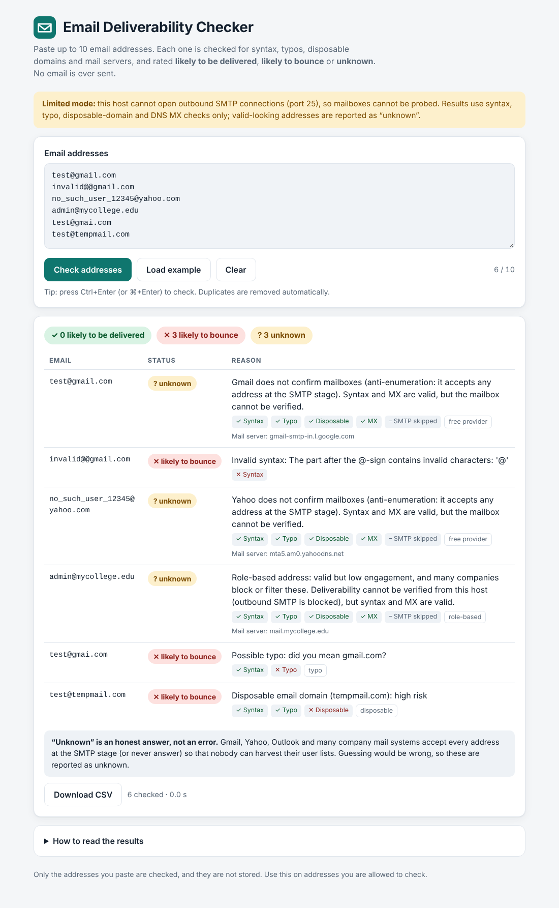

<<<<<<< HEAD
# Email Deliverability Checker

Paste a list of email addresses and see, for each one, whether it is **likely to be delivered**, **likely to bounce**, or **unknown**, with the reason. **The tool never sends an email.**

| | |
|---|---|
| **Live app** | `<PASTE YOUR RENDER URL HERE>` |
| **Source** | `<PASTE YOUR GITHUB REPO URL HERE>` |



Stack: Python 3 · Flask · `email-validator` · `dnspython` · one HTML page with plain JavaScript (`fetch`). No database, no login.

---

## 1. How it works: three layers

Each address goes through the layers in order and stops at the first one that settles it.

| # | Layer | What it does | Outcome |
|---|-------|--------------|---------|
| 1 | **Syntax** | `email-validator` applies the RFC rules (`invalid@@gmail.com`, missing TLD, bad characters, over-length). | invalid → **bounce** |
| 2 | **DNS MX** | Asks DNS for the domain's mail servers (`dnspython`). | NXDOMAIN, no MX, or null MX → **bounce**; DNS timeout → **unknown** |
| 3 | **SMTP** | Connects to the best MX on port 25, `EHLO`, `MAIL FROM`, `RCPT TO:<address>`, then `QUIT`. **`DATA` is never sent.** | see table below |

SMTP replies are interpreted like this:

| Server reply | Result |
|---|---|
| `250` and a made-up address at the same domain is **rejected** | **likely to be delivered**: the server really checks mailboxes |
| `250` and the made-up address is also accepted (**catch-all**) | **likely to be delivered**, flagged `catch-all`: the message would be accepted, but the mailbox itself cannot be confirmed |
| `550` / `551` / `553` (e.g. `5.1.1 User unknown`) | **likely to bounce** |
| `450`, `421`, timeout, refused connection | **unknown** |
| `550 5.7.x`, "blocked", "spamhaus", "sender rejected" (a block on *us*, not on the mailbox) | **unknown** |

Extra rules that run before the DNS/SMTP layers and make the tool smarter:

* **Typo detection**: the domain is compared (Levenshtein distance with adjacent swaps, ≤ 1 edit) with 24 popular mail domains. `test@gmai.com` → *bounce, "Possible typo: did you mean gmail.com?"*. Real look-alikes such as `mail.com`, `email.com`, `q.com` are whitelisted.
* **Disposable domains**: checked against a list of ~10,000 throw-away domains (`data/disposable_domains.txt`) plus extras like `tempmail.com`; sub-domains of listed domains match too → *bounce, "Disposable email domain: high risk"*.
* **Role-based addresses** (`admin@`, `info@`, `support@`, `sales@`, `no-reply@` …) → **unknown**, "valid but low engagement, many companies block or filter these". If the server explicitly rejects the mailbox it is still a bounce.
* **Free-provider rule**: Gmail, Yahoo, Outlook/Hotmail/Live and AOL domains **skip SMTP completely** and return **unknown** (see section 2). Domains whose MX points at big gateways (Google Workspace, Microsoft 365, Mimecast, Proofpoint…) are treated the same way.
* **DNS sanity check**: an NXDOMAIN answer is only believed if a known-good domain resolves too, so a broken or filtering resolver can never turn every address into a false "bounce".

## 2. Why "unknown" happens (anti-enumeration)

If a mail server answered honestly ("this mailbox exists" / "it does not"), spammers could probe it with millions of guesses and harvest its user list. So the big providers **answer `250 OK` to `RCPT TO` for any address** and bounce later, or don't answer probes at all. An SMTP check against Gmail would therefore show *every* address as deliverable, which would be a wrong guess presented as a fact.

This tool deliberately **does not guess**. When the answer cannot be known it says **unknown** and gives the reason. Other causes of `unknown`: greylisting (`450`), temporary failures, policy blocks, unreachable servers, and SMTP being unavailable on the host (next section).

## 3. Hosting limitation: outbound port 25

SMTP checks need **outbound connections to port 25**. Many hosts block it to stop spam, including free tiers of Render and Railway (and similar free hosts). The app handles this on its own:

* On start-up it opens a test connection to a well-known public mail server on port 25 (and caches the answer for 10 minutes). If that fails, it switches to **limited mode** and shows a banner in the page. This avoids waiting for a timeout on every address.
* In limited mode, an address that passes syntax, typo, disposable and MX checks is reported as:
  > **unknown**: Deliverability cannot be verified from this host (outbound SMTP port 25 is blocked), but syntax and MX are valid.

| Check | Deployed on a host that blocks port 25 | Run locally / on a host with port 25 open |
|---|---|---|
| Syntax, typos, disposable domains, role detection | ✅ | ✅ |
| DNS: domain exists, has MX / null MX | ✅ | ✅ |
| Gmail / Yahoo / Outlook, `unknown` by design | ✅ | ✅ |
| Mailbox-level SMTP check (`RCPT TO`) on other domains | ❌ reported as `unknown` | ✅ |
| "likely to be delivered" | ❌ never produced (it needs the SMTP step) | ✅ |

So **the public demo can prove bounces (bad syntax, typos, disposable, dead domains) but cannot confirm that a mailbox exists.** To see the full behaviour, run it on your own machine (some home/ISP networks also block port 25; the banner will tell you).

## 4. Run locally

```bash
git clone <your-repo-url> && cd email-checker
python -m venv .venv && source .venv/bin/activate     # Windows: .venv\Scripts\activate
pip install -r requirements.txt
python app.py
```

Open <http://127.0.0.1:5000>. Click **Load example** to try the sample list.

Optional (recommended before real SMTP checks): set `VERIFY_MAIL_FROM` to an address on a domain you own, e.g. `export VERIFY_MAIL_FROM=check@yourdomain.com`.

Run the tests (no internet needed: DNS is stubbed and SMTP runs against a fake server on localhost):

```bash
python -m unittest discover -s tests -v
```

## 5. API

`POST /api/check` with `{"emails": "a@b.com\nc@d.com"}` (a string or a list):

```json
{
  "results": [
    {"email": "test@gmai.com", "status": "likely to bounce",
     "reason": "Possible typo: did you mean gmail.com?",
     "flags": ["typo"], "checks": {"syntax": "pass", "typo": "fail"},
     "suggestion": "test@gmail.com"}
  ],
  "meta": {"count": 1, "duplicates_removed": 0, "smtp_available": false, "elapsed_ms": 4}
}
```

`GET /api/status` reports whether SMTP probing is available. `GET /healthz` is the health check.

**Limits (so we do not get blacklisted):** at most **10 addresses per request** (HTTP 400 above that), **20 requests/minute per IP** (HTTP 429), SMTP checks run **one at a time with a 1-second pause between them**, at most two MX hosts per address, an overall time budget per request, and a 32 KB body limit.

## 6. Configuration (environment variables)

| Variable | Default | Meaning |
|---|---|---|
| `SMTP_MODE` | `auto` | `auto` detect port 25 · `on` always try · `off` never (syntax + MX only) |
| `VERIFY_MAIL_FROM` | `verify@example.com` | Envelope sender in `MAIL FROM`: use a domain you own |
| `HELO_HOSTNAME` | host FQDN | Name announced in `EHLO` |
| `MAX_EMAILS` | `10` | Addresses per request |
| `SMTP_DELAY` | `1` | Seconds between SMTP checks |
| `SMTP_TIMEOUT` | `8` | Seconds per SMTP operation |
| `RATE_LIMIT_PER_MINUTE` | `20` | Requests per IP per minute |

## 7. Deploy to Render (free)

1. Push this folder to a new GitHub repository.
2. On [render.com](https://render.com): **New + → Blueprint**, pick the repo (it reads `render.yaml`), or **New + → Web Service** with
   *Build command* `pip install -r requirements.txt` and
   *Start command* `gunicorn app:app --workers 1 --threads 4 --timeout 120 --bind 0.0.0.0:$PORT`.
3. After the first deploy open the URL; the banner will say **Limited mode** if port 25 is blocked (expected on the free tier).

Why one worker: the rate limiter, the SMTP pause and the port-25 cache live in process memory. The free tier also sleeps after inactivity, so the first request can take ~30–60 s.

## 8. Ethics and safety

* **No email is ever sent.** The SMTP step stops after the `RCPT TO` reply and quits; the `DATA` command is never issued (a test asserts this).
* The tool is polite: one SMTP check at a time, a 1-second delay between them, rate limits, small batches. It probes only the addresses you paste, so use it on addresses you are entitled to check (your own lists, users who signed up with you). It is not a harvesting tool and gives no way to enumerate a domain's mailboxes.
* Pasted addresses are processed in memory and are not stored or logged.
* Output is a **probability, not a guarantee**: "likely to be delivered" can still bounce later, and "unknown" really is unknown.

## Project structure

```
email-checker/
├── app.py                 Flask app: routes, limits, security headers
├── checker.py             The verification logic (3 layers + extras)
├── templates/index.html   Single-page UI (textarea, button, results table)
├── data/disposable_domains.txt
├── tests/test_checker.py  55 tests incl. a fake SMTP server
├── requirements.txt  Procfile  render.yaml  .env.example
└── README.md
```

## Credits

Disposable-domain list: [disposable-email-domains](https://github.com/disposable-email-domains/disposable-email-domains) (CC0). Libraries: Flask, email-validator, dnspython, gunicorn.
=======
# email-checker
A web application that checks a list of email addresses and reports whether each one is likely to be delivered, likely to bounce, or unknown.
>>>>>>> 4472ceedfdf27ca2fbc93dde5fb41caae3964471
